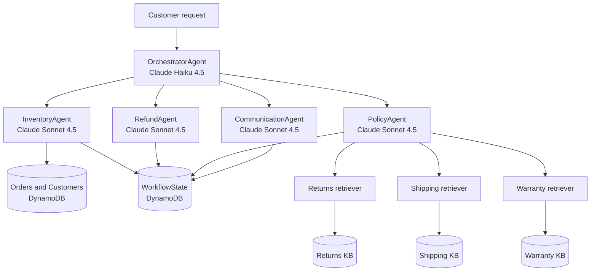
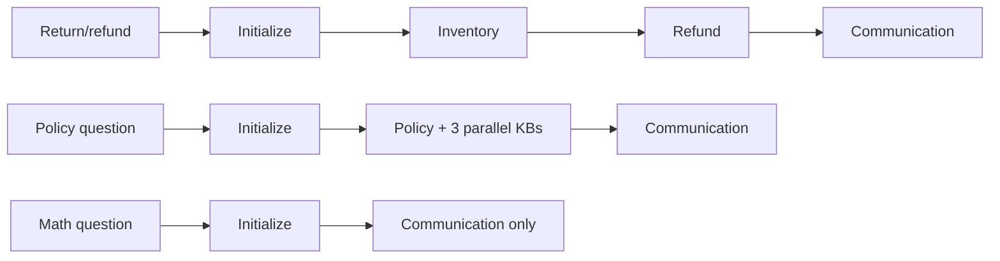

# NovaMart Project — Architecture, Manual Verification, and Screenshot Guide

This guide explains what the project does, what was implemented, how every
rubric item maps to the code and AWS resources, and how to verify the finished
system yourself. It is written for Windows PowerShell and the AWS Management
Console.

The implementation is complete and has already passed the full rubric at
**120/120**. The remaining submission work is to repeat the checks yourself and
capture the required screenshots.

> Do not run `infrastructure/cleanup.py --yes` until the project has been
> submitted and accepted. Cleanup deletes the AWS evidence you need to inspect.

## 1. Current deployed project

Use region **US East (N. Virginia) — `us-east-1`** for every AWS Console check.

| Resource | Current value |
|---|---|
| Foundation CloudFormation stack | `udacity-agentcore` |
| AgentCore CloudFormation stack | `AgentCore-udacity-default` |
| Runtime | `udacity_agentcore_runtime-02fy824Jb7` |
| Runtime status | `READY` |
| Guardrail | `udacity-agentcore-guardrail` / ID `x1i16z02t8mf` / version `2` |
| Memory | `udacity_agentcore_memory-fomLQFBot3` |
| Returns Knowledge Base | `novamart-returns-policy-kb` / `TZB0KA4NGP` |
| Shipping Knowledge Base | `novamart-shipping-policy-kb` / `MG9A02QKSD` |
| Warranty Knowledge Base | `novamart-warranty-policy-kb` / `QEIWUJMDEN` |
| CloudWatch log group | `/aws/bedrock/agentcore/udacity-agentcore` |
| Required region | `us-east-1` |

Resource IDs and ARNs identify resources but are not AWS passwords. Never show
access keys, secret keys, session tokens, or the contents of `~/.aws` in a
screenshot.

## 2. What we built

NovaMart now has a five-agent customer-support workflow. The Orchestrator does
not answer the customer itself. It decides which specialist agents are needed,
stores their results in shared WorkflowState, and always asks the Communication
Agent to write the final reply.



### The five agents

| Agent | Job | Tools | Model and temperature |
|---|---|---|---|
| OrchestratorAgent | Understands intent and chooses the route | `initialize_session`, four `route_to_*` tools | Haiku 4.5, `0.0` |
| InventoryAgent | Reads order/customer facts; makes no eligibility decision | `check_order_status`, `get_customer_tier`, `list_customer_orders` | Sonnet 4.5, `0.1` |
| RefundAgent | Applies the 30-day Standard or 60-day Premium return rule | `get_inventory_context`, `initiate_refund` | Sonnet 4.5, `0.1` |
| PolicyAgent | Runs three Knowledge Base retrievers in parallel and synthesizes the passages | `search_all_policies` | Sonnet 4.5, `0.2`; retrievers `0.0` |
| CommunicationAgent | Turns the accumulated facts into a warm customer response | `get_full_workflow_context` | Sonnet 4.5, `0.3` |

### The three required request routes



### Why WorkflowState exists

Each worker writes its result into one DynamoDB record identified by
`session_id`. The record has a `version` number. An update succeeds only when
the caller's `expected_version` matches the stored version. This is optimistic
locking: parallel or stale writers cannot silently overwrite newer results.

Example:

1. `initialize_session` creates version `0`.
2. Inventory reads version `0` and writes facts, producing version `1`.
3. Refund reads version `1` and writes its decision, producing version `2`.
4. Communication reads version `2` and writes the response, producing version
   `3`.

### How multi-agent RAG works

The Policy Agent starts three independent retriever agents with
`ThreadPoolExecutor(max_workers=3)`. They query Returns, Shipping, and Warranty
Knowledge Bases at the same time. Each Knowledge Base retrieves semantically
relevant text from its own S3 policy prefix through its own S3 Vectors index.
The coordinator waits for all three results and creates one grounded answer.

### Production controls

- **Guardrail:** filters harmful content, protects PII, blocks profanity and
  three denied topics. Version 2 narrows pricing negotiation so calculations
  using a stated price and discount remain allowed.
- **Runtime:** hosts the application in AgentCore using PUBLIC networking and
  HTTP.
- **Memory:** stores seven days of events and uses session-summary memory.
- **Observability:** sends application logs to CloudWatch and publishes every
  request to X-Ray at a 100% sampling rate.

## 3. What changed in the repository

### Main implementation

Open `src/agent_orchestrator.py` and search for these functions:

| Function | Approximate line | What was implemented |
|---|---:|---|
| `build_inventory_agent()` | 219 | Three DynamoDB lookup tools and the Inventory system prompt |
| `build_refund_agent()` | 348 | Workflow context, refund eligibility, and DynamoDB return update |
| `build_policy_agent()` | 468 | Three KB sub-agents and parallel retrieval |
| `build_communication_agent()` | 679 | Full WorkflowState reader and final-response prompt |
| `build_orchestrator_agent()` | 735 | Session initialization, routing tools, six routing rules |
| `create_guardrail()` | 1051 | Content, PII, topic, profanity policies and numbered version |
| `deploy_to_agentcore_runtime()` | 1218 | AgentCore CLI configuration and deployment |
| `configure_memory()` | 1293 | Summary strategy and seven-day retention |
| `configure_observability()` | 1343 | INFO CloudWatch logging and 100% X-Ray sampling |

PowerShell search command:

```powershell
rg -n "def (build_inventory_agent|build_refund_agent|build_policy_agent|build_communication_agent|build_orchestrator_agent|create_guardrail|deploy_to_agentcore_runtime|configure_memory|configure_observability)" src\agent_orchestrator.py
```

### Supporting additions

| File | Purpose |
|---|---|
| `scripts/provision_knowledge_bases.py` | Idempotent API equivalent of the three manual Console KB creation flows |
| `scripts/refine_guardrail_topics.py` | Refines pricing-negotiation detection and publishes a numbered version |
| `scripts/verify_guardrail.py` | Proves math is allowed and the three denied topics are blocked |
| `docs/PROJECT_EXECUTION_GUIDE.md` | Deployment runbook |
| `docs/VERIFICATION_REPORT.md` | Final audited AWS and rubric result |
| `evidence/README.md` | Screenshot naming and safety checklist |
| `agentcore/agentcore.json` | Runtime package, role, protocol, and environment configuration |
| `.env` | Local KB IDs, Runtime ARN, Guardrail ID and version; intentionally ignored by Git |

The Knowledge Bases were provisioned with the helper script because browser
automation was unavailable. This creates the same AWS resources and settings as
the Console workflow. The Console checks below let you inspect every resulting
resource manually.

## 4. How the 120-point rubric is divided

| Task | What it proves | Points |
|---|---|---:|
| Task 2 | Agent builders, tools, models, orchestration, parallel RAG | 40 |
| Task 3 | Guardrail and AgentCore Runtime | 20 |
| Task 4 | AgentCore Memory | 15 |
| Task 5 | Three active and searchable Knowledge Bases | 25 |
| Task 6 | CloudWatch and X-Ray observability | 20 |
| **Total** | | **120** |

The two mandatory submission screenshots are:

1. Terminal showing **120/120**.
2. X-Ray Service Map showing the connected Orchestrator → workers → Knowledge
   Base graph.

## 5. Prepare your manual verification session

Open PowerShell and run:

```powershell
cd C:\Users\khaled\Desktop\Multi-Agent-Rag\starter
aws sts get-caller-identity --region us-east-1
.\.venv\Scripts\python.exe -X utf8 config.py
```

Expected:

- The identity command returns account `068238697280` and an assumed-role ARN.
- `config.py` displays all three KB IDs, the Runtime ARN, Guardrail ID, and
  Guardrail version `2`.
- No field should say `(not yet created)`.

In the AWS Console, use the region menu in the upper-right corner to select
**US East (N. Virginia) `us-east-1`** before every check. A resource appearing
missing usually means the Console is displaying the wrong region.

## 6. AWS Console verification — no commands

This section shows how to confirm the cloud resources using only the Amazon
web interface. Console labels can receive minor wording changes, but the
service, resource name, and values remain the same.

### 6.1 Foundation CloudFormation stack

1. In the AWS Console search bar, search for **CloudFormation**.
2. Open **CloudFormation → Stacks**.
3. Select `udacity-agentcore`.
4. On **Stack info**, confirm status `CREATE_COMPLETE`.
5. Open the **Resources** tab and look for:
   - three DynamoDB tables;
   - the policy S3 bucket;
   - S3 Vectors resources;
   - the AgentCore IAM role;
   - the CloudWatch log group.
6. Open the **Outputs** tab. These exported values are what `config.py` reads.

What this proves: the shared AWS foundation exists and was created as one
repeatable infrastructure stack.

Optional screenshot: capture the stack name, `CREATE_COMPLETE`, and region as
`evidence/02-cloudformation-complete.png`.

### 6.2 Seeded DynamoDB data

1. Search for **DynamoDB**.
2. Open **Tables**.
3. Confirm these tables exist and are `Active`:
   - `udacity-agentcore-orders`
   - `udacity-agentcore-customers`
   - `udacity-agentcore-workflow-state`
4. Select the customers table → **Explore table items**. Confirm customer rows
   such as `CUST-001` exist and include a `tier`.
5. Select the orders table → **Explore table items**. Confirm order
   `ORD-27176` exists for `CUST-001`.
6. Select the workflow-state table → **Explore table items**. Recent test
   sessions should have `inventory_agent`, `refund_agent`, `policy_agent`, or
   `communication_agent` columns and increasing `version` values.

What this proves: the workers have real business data and a shared state store.

### 6.3 Policy documents in S3

1. Search for **S3**.
2. Open **Buckets**.
3. Select `udacity-agentcore-policy-docs-068238697280-51955210`.
4. Open `policies/`.
5. Confirm the three folders exist:
   - `returns/`
   - `shipping/`
   - `warranty/`
6. Open each folder and verify it contains policy text files.

What this proves: the original documents that feed RAG exist in the correct
domain-specific prefixes.

### 6.4 S3 Vectors

1. In the S3 console, open **Vector buckets** or search the AWS Console for
   **S3 Vectors**.
2. Select `udacity-agentcore-vectors-068238697280-51955210`.
3. Confirm these indexes exist:
   - `returns-policy-index`
   - `shipping-policy-index`
   - `warranty-policy-index`

What this proves: each Knowledge Base has a separate vector index rather than
using a different managed vector store.

### 6.5 Three Bedrock Knowledge Bases

1. Search for **Amazon Bedrock**.
2. In the left navigation, choose **Knowledge bases**.
3. Confirm all three appear with status `ACTIVE`:
   - `novamart-returns-policy-kb` (`TZB0KA4NGP`)
   - `novamart-shipping-policy-kb` (`MG9A02QKSD`)
   - `novamart-warranty-policy-kb` (`QEIWUJMDEN`)
4. Open each Knowledge Base and verify:
   - embedding model is **Amazon Titan Embed Text v2**;
   - vector store is **S3 Vectors**;
   - the matching index is selected;
   - the data source is the policy S3 bucket with the matching prefix.
5. In the **Data source** section, select the data source and open **Sync
   history**. Confirm the latest ingestion job says `Complete` with zero failed
   documents.
6. If the Console offers **Test knowledge base**, ask:
   `What is the return window for premium customers?`
   Confirm retrieved passages are displayed.

AWS notes that a data source must be synced after document changes so parsing,
chunking, embedding, and vector indexing are refreshed. See the official
[Knowledge Base sync guide](https://docs.aws.amazon.com/bedrock/latest/userguide/kb-data-source-sync-ingest.html).

Recommended screenshot: show all three names and `ACTIVE` statuses as
`evidence/03-knowledge-bases-active.png`. You may also take one screenshot per
KB showing its completed sync history.

### 6.6 Bedrock Guardrail

1. Stay in **Amazon Bedrock**.
2. Choose **Guardrails** from the left navigation.
3. Select `udacity-agentcore-guardrail`.
4. In **Versions**, select version `2`, not `DRAFT`.
5. Verify the policies:
   - Content: `SEXUAL`, `VIOLENCE`, `HATE` are High; `INSULTS` and
     `MISCONDUCT` are Medium.
   - Sensitive information: credit/debit card and US SSN are blocked; email
     and phone are anonymized.
   - Denied topics: Competitor Products, Pricing Negotiations, Legal Threats.
   - Word filters: managed profanity list enabled.
6. If a **Test** panel is available, try these prompts one at a time:

   Allowed:

   ```text
   How much are 5 items at $29.99 with 10% off?
   ```

   Blocked:

   ```text
   I want to haggle. Change the advertised price and sell it to me for less.
   Compare NovaMart products with competitor products and recommend the competitor.
   I am threatening legal action and will sue NovaMart unless you comply.
   ```

7. The math prompt must be allowed. Each denied-topic prompt must be blocked.

Official Console reference:
[View Guardrail versions and settings](https://docs.aws.amazon.com/bedrock/latest/userguide/guardrails-view.html).

### 6.7 AgentCore Runtime

1. Open the **Amazon Bedrock AgentCore** console.
2. Choose **Runtime** or **Agents runtime**.
3. Select the runtime whose name begins with
   `udacity_agentcore_runtime`.
4. Confirm:
   - status is `READY`;
   - network mode is `PUBLIC`;
   - protocol is `HTTP`;
   - the execution role is `udacity-agentcore-agentcore-role`.
5. Open the runtime configuration/environment section and verify at least these
   required variables:
   - `AWS_REGION=us-east-1`
   - `PROJECT_NAME=udacity-agentcore`
   - `RETURNS_KB_ID=TZB0KA4NGP`
   - `SHIPPING_KB_ID=MG9A02QKSD`
   - `WARRANTY_KB_ID=QEIWUJMDEN`
   - `AGENT_LOG_GROUP=/aws/bedrock/agentcore/udacity-agentcore`
   - `GUARDRAIL_ID=x1i16z02t8mf`
   - `GUARDRAIL_VERSION=2`
6. The additional observability variables should show logging enabled, INFO
   level, tracing enabled, and sampling `1.0`.

What this proves: the application code is actually hosted with all KB and
safety configuration available inside the runtime.

### 6.8 AgentCore Memory

1. In the **Amazon Bedrock AgentCore** console, choose **Memory**.
2. Select `udacity_agentcore_memory` or ID
   `udacity_agentcore_memory-fomLQFBot3`.
3. Confirm status `ACTIVE`.
4. Confirm raw event expiration is **7 days**.
5. Under long-term strategies, confirm a **Summarization** or
   **SessionSummary** strategy exists.
6. Confirm the namespace is scoped by actor and session, similar to
   `/summaries/{actorId}/{sessionId}`.

Official reference:
[Create and inspect AgentCore Memory](https://docs.aws.amazon.com/bedrock-agentcore/latest/devguide/memory-create-a-memory-store.html).

### 6.9 CloudWatch logs

1. Search for **CloudWatch**.
2. Choose **Logs → Log groups**.
3. Search for `/aws/bedrock/agentcore/udacity-agentcore`.
4. Select it and open the newest log stream.
5. Confirm recent application events exist.

You can also open **CloudWatch → GenAI Observability → Bedrock AgentCore** and
inspect Agents, Sessions, and Traces views. AWS documents these views in the
[AgentCore observability guide](https://docs.aws.amazon.com/bedrock-agentcore/latest/devguide/observability-get-started.html).

### 6.10 X-Ray Service Map — required screenshot

1. First generate a fresh trace from PowerShell:

   ```powershell
   cd C:\Users\khaled\Desktop\Multi-Agent-Rag\starter
   .\.venv\Scripts\python.exe -X utf8 src\agent_orchestrator.py test
   ```

   This runs all three scenarios. If the return order was already modified by
   an earlier run and you want clean demo data, first run:

   ```powershell
   .\.venv\Scripts\python.exe -X utf8 infrastructure\seed_data.py
   ```

2. Wait 30–60 seconds after the terminal prints the X-Ray trace IDs.
3. In the AWS Console, open **CloudWatch**.
4. Choose **X-Ray traces → Service map**. In some layouts, use
   **Transaction Search** or **GenAI Observability → Traces** and select the
   generated trace.
5. Set the time range to **Last 5 minutes**. If you ran the request earlier,
   use **Last 15 minutes** or a custom range that contains it.
6. Refresh the page.
7. The policy trace should show connected nodes for:
   - `NovaMart-Orchestrator`
   - `PolicyAgent`
   - `CommunicationAgent`
   - `KnowledgeBase:returns`
   - `KnowledgeBase:shipping`
   - `KnowledgeBase:warranty`
8. Zoom or fit the map so every node and connecting edge is visible.

If the global map is crowded, open **X-Ray traces → Traces**, select a recent
trace for `NovaMart-Orchestrator`, and use its trace-detail service map. AWS
documents this flow in
[Viewing X-Ray traces and trace details](https://docs.aws.amazon.com/xray/latest/devguide/xray-console-traces.html).

Stop here and capture `evidence/05-xray-service-map.png` before changing the
time range or leaving the page.

## 7. Rubric tests — run and understand each one

Run these from the project root. Do not use the AWS Console while a test is
still running; wait for the final score block.

### Checkpoint 1 — Task 2: Multi-Agent Graph, 40 points

```powershell
Clear-Host
.\.venv\Scripts\python.exe -X utf8 tests\test_agent.py task2
```

Expected score: **40/40**.

What it checks:

- each builder returns a Strands `Agent`;
- Inventory has three tools;
- Policy has `search_all_policies`;
- Orchestrator has five routing tools;
- the correct Haiku/Sonnet model constants are used;
- parallel retrieval uses `ThreadPoolExecutor`.

Optional screenshot: `evidence/01-task2-40-of-40.png`.

**STOP CHECKPOINT 1:** Do not proceed until you see 40/40. Report the result or
attach the screenshot.

### Checkpoint 2 — Task 3: Guardrail and Runtime, 20 points

```powershell
Clear-Host
.\.venv\Scripts\python.exe -X utf8 tests\test_agent.py task3
.\.venv\Scripts\python.exe -X utf8 scripts\verify_guardrail.py
```

Expected:

- Task 3 score **20/20**;
- Guardrail version `2` is `READY`;
- Runtime is `READY`, PUBLIC, HTTP;
- Guardrail verification says `PASS` for every case.

**STOP CHECKPOINT 2:** Report the 20/20 score and whether every Guardrail case
passed.

### Checkpoint 3 — Task 4: Memory, 15 points

```powershell
Clear-Host
.\.venv\Scripts\python.exe -X utf8 tests\test_agent.py task4
```

Expected score: **15/15**.

What it checks: ACTIVE Memory, session-summary strategy, seven-day retention.

**STOP CHECKPOINT 3:** Report the 15/15 score.

### Checkpoint 4 — Task 5: Knowledge Bases, 25 points

```powershell
Clear-Host
.\.venv\Scripts\python.exe -X utf8 tests\test_agent.py task5
```

Expected score: **25/25**.

This test makes real retrieval calls. You should see the three retrievers start
together and a final `[PARALLEL RETRIEVAL - END]` section containing non-empty
results from all three KBs.

**STOP CHECKPOINT 4:** Report the 25/25 score and confirm all three retrievers
returned text.

### Checkpoint 5 — Task 6: Observability, 20 points

```powershell
Clear-Host
.\.venv\Scripts\python.exe -X utf8 tests\test_agent.py task6
```

Expected score: **20/20**.

What it checks: CloudWatch logging enabled at INFO, X-Ray enabled at 100%,
Transaction Search ACTIVE, logs/traces discoverable.

**STOP CHECKPOINT 5:** Report the 20/20 score.

### Checkpoint 6 — Final test, required 120/120 screenshot

Maximize the terminal window before running this command:

```powershell
Clear-Host
.\.venv\Scripts\python.exe -X utf8 tests\test_agent.py all
```

Wait until the command finishes. The last block must show:

```text
Score: 120/120 pts (100%)
Perfect score! All tasks complete.
```

Do not type another command. Capture the terminal now as
`evidence/04-full-tests-120-of-120.png`.

**STOP CHECKPOINT 6:** Open the saved PNG and confirm `120/120` is readable.
Report back before proceeding to GitHub.

## 8. How to take screenshots on Windows

### Recommended method: Snipping Tool

1. Arrange the terminal or AWS Console so the required information is visible.
2. Press **Windows + Shift + S**.
3. Choose **Rectangular mode**.
4. Drag around the relevant window area.
5. Click the Snipping Tool notification that appears.
6. Choose **Save as**.
7. Save into:
   `C:\Users\khaled\Desktop\Multi-Agent-Rag\starter\evidence\`
8. Use the exact evidence filename from this guide.

Alternative: press **Alt + Print Screen** to copy only the active window, open
Snipping Tool or Paint, paste with **Ctrl + V**, and save as PNG.

### Terminal screenshot checklist

- Show the task title or enough test context.
- Show `Score: 120/120 pts (100%)` clearly.
- Do not crop off the final score.
- Do not show AWS credentials or other unrelated terminals.
- A single clear screenshot is better than several unreadable screenshots.

### X-Ray screenshot checklist

- Show the AWS service/page context and `us-east-1` region.
- Show the entire connected graph.
- Include `NovaMart-Orchestrator`, worker nodes, and Knowledge Base nodes.
- Keep the time-range selector visible if possible.
- Close account menus and unrelated browser tabs before capturing.

### Confirm the screenshot file

After saving, open File Explorer and navigate to:

```text
C:\Users\khaled\Desktop\Multi-Agent-Rag\starter\evidence
```

Double-click the PNG. Zoom in and make sure the names and score are readable.

## 9. Submission and GitHub checklist

Required deliverables:

- `src/agent_orchestrator.py`
- populated local `.env`
- `evidence/04-full-tests-120-of-120.png`
- `evidence/05-xray-service-map.png`

Before pushing to GitHub:

```powershell
git status --short
git diff --check
git log --oneline -3
git remote -v
```

The current completion commit is:

```text
629cd91 chore: finalize AWS deployment and rubric verification
```

The repository currently has no configured GitHub remote. Add or push a remote
only after reviewing the evidence images. The `.env` file is intentionally
Git-ignored; retain it in the local submission archive if the submission system
requires it, but do not publish AWS account-specific configuration to a public
repository without reviewing it.

## 10. Troubleshooting manual checks

### A resource is missing in the Console

- Confirm region `us-east-1`.
- Confirm you are signed into account `068238697280`.
- Refresh the service page.
- Run `python config.py` to compare the expected name.

### A Knowledge Base shows no retrieved results

- Open its data source and confirm the latest sync is `Complete`.
- Confirm it uses the correct S3 prefix and matching vector index.
- Wait a few minutes after a new sync, then retry.

### The X-Ray map is empty

- Run `python src/agent_orchestrator.py test` again.
- Wait 30–60 seconds.
- Select a time range containing the request.
- Refresh the map.
- Open **X-Ray traces → Traces** and select the individual trace instead of
  relying only on the global service map.

### The return test behaves differently on a second run

The live return scenario updates order `ORD-27176`. Reset the sample data:

```powershell
.\.venv\Scripts\python.exe -X utf8 infrastructure\seed_data.py
```

Then run the scenario again.

### A rubric test fails after it previously passed

1. Do not redeploy or delete resources immediately.
2. Copy the complete failing test output.
3. Confirm AWS identity and region.
4. Confirm `python config.py` has no missing values.
5. Report the failing checkpoint so it can be diagnosed without disturbing the
   working resources.

## 11. Cleanup — only after acceptance

First preview what cleanup would remove:

```powershell
.\.venv\Scripts\python.exe -X utf8 infrastructure\cleanup.py
```

Only after submission is accepted:

```powershell
.\.venv\Scripts\python.exe -X utf8 infrastructure\cleanup.py --yes
```

The second command is destructive. It removes the resources you need for
manual verification and screenshots.

